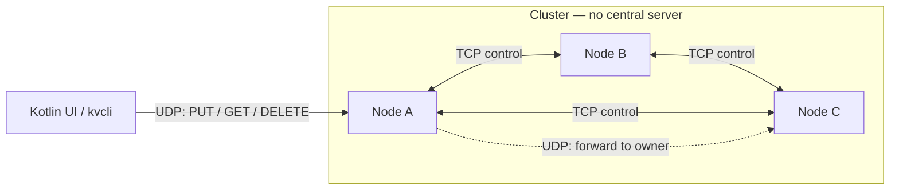
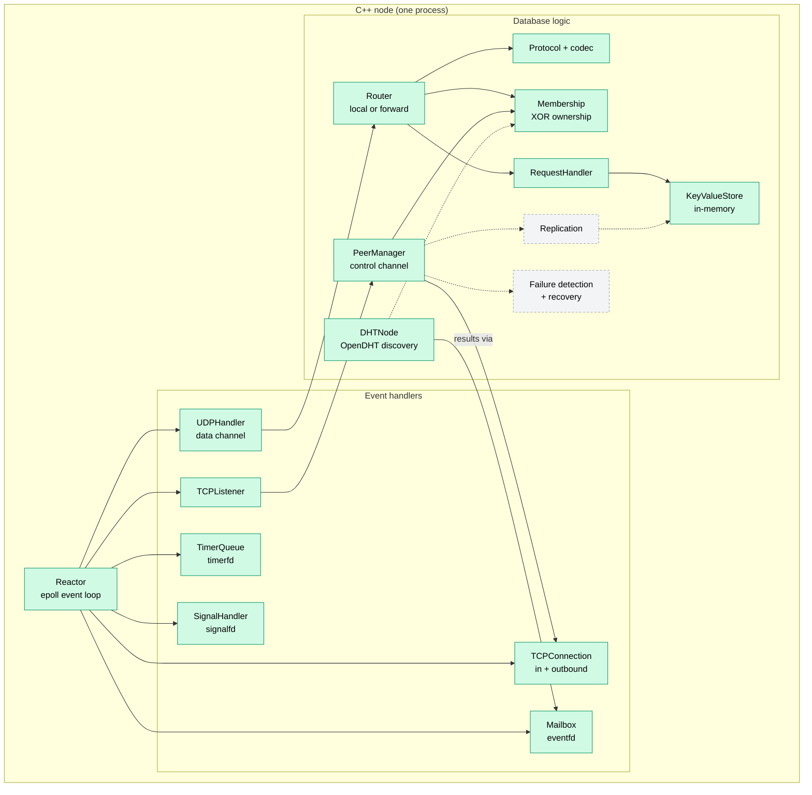
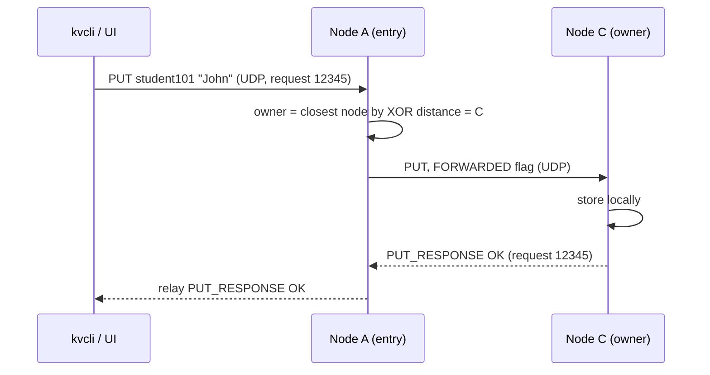
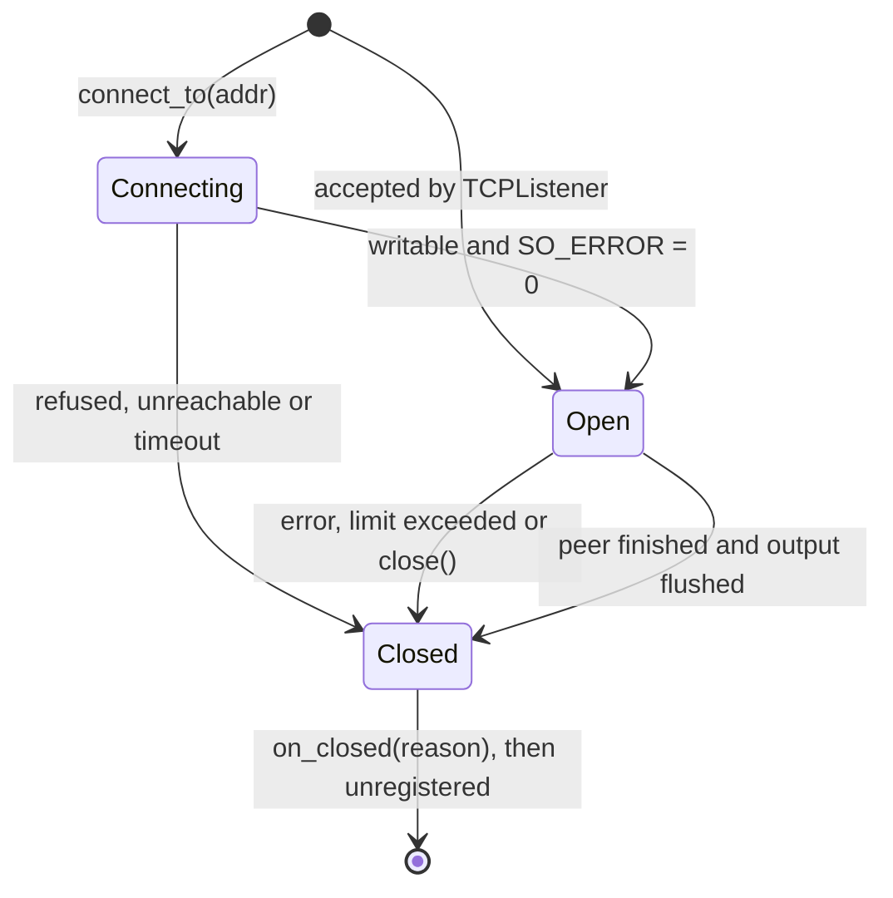

# Distributed Key-Value Database — Hybrid UDP/TCP Networking

A decentralized, in-memory key-value database written in **C++23** for Linux.
Data is spread across independent nodes with no central server: every node can
accept any request, keys are placed on nodes by XOR distance, and requests for
keys owned by another node are forwarded there transparently.

- **UDP data channel** — `PUT` / `GET` / `DELETE` from clients and between nodes,
  over a custom binary protocol with request IDs, timeouts and retries.
- **TCP control channel** — one connection between every pair of nodes, with a
  handshake, a live membership table and automatic reconnects. It carries
  heartbeats and replication next.
- **XOR-distance key placement** — every node computes the owner of a key on its
  own; no node has to be asked.
- **OpenDHT** — node discovery in a private DHT (built, to be wired into membership).
- **One epoll event loop per node** — all sockets, timers, signals and cross-thread
  work handled by a single thread, no locks inside the engine.
- **Kotlin desktop UI** — sends commands and visualizes the cluster (separate component).

> **Status:** a working multi-node database. Clients read and write through any
> node; nodes route requests to the key's owner over UDP and keep TCP control
> connections to each other. **Next:** replication, so data survives the loss of
> its owner — see [Roadmap](#roadmap).

---

## Contents

- [Architecture](#architecture)
- [Engine design principles](#engine-design-principles)
- [What is implemented](#what-is-implemented)
- [Project structure](#project-structure)
- [Building](#building)
- [Running](#running)
- [Testing](#testing)
- [Roadmap](#roadmap)
- [Team](#team)

---

## Architecture

Clients talk to **any** node. The node that receives a request computes which
node owns the key and either handles it or forwards it there.



Inside each node (green = implemented, grey = planned):



A `PUT` today, entering at a node that isn't the owner:



With replication (next), node C will also send `REPLICA_PUT` to a second node
over TCP and answer only after that node acknowledges.

---

## Engine design principles

These rules hold across the whole engine and keep it simple and safe.

**1. Single-threaded reactor.**
Each node runs one epoll event loop. Every socket, timer, signal and cross-thread
notification is a handler in that loop, so engine state is only ever touched by
one thread — no locks needed.

**2. Other threads never touch engine state.**
OpenDHT runs its own threads. Its callbacks only copy their results and *post* a
task to the `Mailbox`; the task runs on the reactor thread.

**3. Handlers own their file descriptors; the reactor owns the handlers.**
Every descriptor lives in a `UniqueFD` inside its handler. The reactor stores
handlers (`std::unique_ptr<EventHandler>`) and identifies them by pointer — it
never stores or exposes descriptors, and only touches one when calling `epoll_ctl`.

**4. Handlers don't know the reactor.**
Handlers communicate outward only through callbacks (`std::move_only_function`).
The code that creates a handler wires those callbacks to the reactor.

**5. Logic doesn't know sockets.**
`RequestHandler`, `Router` and `PeerSession` take bytes in and hand bytes out
through callbacks. They are tested with simulated networks in memory — no ports,
no timing flakiness.

**6. Edge-triggered epoll.**
Handlers read / accept / write until `EAGAIN`, because epoll reports each
readiness change only once.

**7. Deferred destruction.**
`unregister_handler()` removes a handler from epoll immediately but destroys it
only after the current batch of events. The `PeerManager` applies the same idea
to closed connections, which may still be on the call stack when they close.

**8. Never trust the network.**
Every incoming message is fully validated before use. Invalid UDP datagrams are
dropped; a TCP connection that sends one invalid message is closed.

**9. Errors.**
Setup failures (socket, bind, listen, bad arguments) stop the node at startup.
Runtime failures never throw out of the event loop: they close the affected
connection or answer with an error status.

---

## What is implemented

### Utilities — `src/utils/`

| Component | Description |
|---|---|
| `UniqueFD` | Move-only RAII owner of a file descriptor; closes it exactly once. |
| `error_utils.h` | `throw_errno()` helpers that turn `errno` into `std::system_error`. |
| `address.h` | `make_address(ip, port)`, `parse_endpoint("[::1]:9001")`, and `to_string(addr)` for logs. IPv4 is mapped to `::ffff:a.b.c.d`. |

### Reactor and event handlers — `src/reactor/`, `src/handlers/`

| Component | Description |
|---|---|
| `Reactor` | epoll loop, edge-triggered, deferred destruction, `stop()`. |
| `UDPHandler` | Non-blocking dual-stack UDP socket; reads every pending datagram per event. |
| `TCPListener` | Accepts until the backlog is empty; `SO_REUSEADDR` so nodes restart immediately. |
| `TCPConnection` | Inbound and outbound (non-blocking connect), framing-agnostic reading, write queue, half-close, size limits, close reasons. |
| `TimerQueue` | Many timers on one `timerfd` (min-heap): one-shot and drift-free repeating. |
| `Mailbox` | `eventfd` + queue: other threads post tasks that run on the reactor thread. |
| `SignalHandler` | `signalfd`: Ctrl+C / `SIGTERM` become events → clean shutdown, exit code 0. |



### Protocol — `src/protocol/`, specification in [`docs/protocol.md`](docs/protocol.md)

- One format for UDP and TCP: a **28-byte header** (magic `"KV"`, version, type,
  flags, status, `request_id`, `sender_id`, length) plus a payload.
- **Big-endian** integers, bounds-checked readers (`ByteReader` / `ByteWriter`).
- Limits chosen so every request fits in **one UDP datagram** (≤ 1232 bytes, never
  fragmented): keys ≤ 128 bytes, values ≤ 1024 bytes.
- `try_parse_message` for TCP streams (complete / need more / invalid),
  `parse_datagram` for UDP. Errors are values (`std::expected`), never exceptions.
- A huge `length` is rejected from the header alone, so a peer can't make a node
  buffer gigabytes.

### Storage and request handling — `src/storage/`, `src/node/`

**`KeyValueStore`** — `std::unordered_map` with `put`, `get` (`std::optional`) and
`remove`. Values may contain any bytes.

**`RequestHandler`** — the database logic of one node: decodes a request, applies
it to the store, builds the response (`OK`, `NOT_FOUND`, `KEY_TOO_LARGE`, …).
Every response copies `request_id` and `sender_id`, so clients match answers to
requests. Messages that aren't client requests get no answer.

**`Router`** — decides, for every request on the data channel:

| Situation | Action |
|---|---|
| This node owns the key | handle locally, reply |
| Another node owns it | forward with the `FORWARDED` flag, remember the client, relay the owner's answer |
| Owner doesn't answer within 300 ms | reply `UNAVAILABLE` |
| Request already `FORWARDED`, and we're not the owner | reply `UNAVAILABLE` — never forward twice (loop protection) |
| Client retries while the first attempt is pending | ignored — the pending forward answers |
| A response from a node we didn't forward to | ignored |

### Cluster — `src/cluster/`

**Node identity** — a node's ID is the hash of its canonical address
(`"[::1]:9001"`). No IDs to configure, and every node computes the same ID for
every other node.

**Hashing (`hash.h`)** — FNV-1a 64-bit followed by a SplitMix64 mixing step.
Deterministic across machines and compilers (unlike `std::hash`); the mixing step
spreads similar keys into different high bits, which XOR distance depends on.

**`Membership`** — the node list and **ownership**: the owner of a key is the node
with the smallest `node_id XOR hash(key)`. A pure function of (key, node list), so
all nodes agree without communicating.

**`PeerSession`** — the control-channel protocol of one TCP connection:
`HELLO` → `HELLO_ACK`, then every other control message is handed on with the
peer's verified ID. Any protocol violation closes the connection.

**`PeerManager`** — the control channel of a node:

- **One connection per pair of nodes:** only the node with the **lower ID**
  connects; the other accepts. Same port number as the UDP data channel.
- **Membership table:** `CONNECTING` / `CONNECTED` / `DISCONNECTED` per peer.
- **Handshake timeout** (3 s, includes the TCP connect) and **reconnect with
  backoff** (0.25 s doubling up to 4 s), logged once instead of on every attempt.
- A reconnecting peer **replaces** a stale old connection.
- `send(peer_id, message)` for replication and heartbeats.

### DHT — `src/dht/`

**`DHTNode`** — node discovery through OpenDHT on a private network: nodes
announce their `NodeInfo` under a shared cluster key and listen for the others.
Callbacks arrive through the `Mailbox`. Built and verified with several
processes; wiring it into `Membership` (replacing the static `--peer` list) is on
the roadmap.

---

## Project structure

```
k_v_db/
├── CMakeLists.txt
├── main.cpp                     # the database node
├── docs/
│   └── protocol.md              # wire protocol specification
├── src/                         # engine — compiled into the kvdb_core library
│   ├── reactor/                 # epoll event loop
│   ├── handlers/                # UDP, TCP listener/connection, timers, mailbox, signals
│   ├── protocol/                # header, codec, byte-order helpers
│   ├── storage/                 # KeyValueStore
│   ├── node/                    # RequestHandler, Router
│   ├── cluster/                 # hashing, Membership, PeerSession, PeerManager
│   ├── dht/                     # OpenDHT discovery
│   └── utils/                   # UniqueFD, errors, addresses
├── tools/
│   ├── kvcli.cpp                # command-line client
│   ├── engine_demo.cpp          # foundation demo: echo, timers, mailbox
│   └── dht_spike.cpp            # multi-process discovery test
└── tests/                       # GoogleTest unit tests
```

**CMake layout:** all engine code is built once into the static library
`kvdb_core`, which also carries the include path, warning flags and dependencies
(Threads, OpenDHT). Every executable — `k_v_db`, `kvcli`, `engine_demo`,
`dht_spike`, `unit_tests` — links `kvdb_core`.

---

## Building

### Requirements

- Linux (epoll, timerfd, eventfd, signalfd)
- GCC 14+ or Clang with C++23 support
- CMake 4.3+
- [OpenDHT](https://github.com/savoirfairelinux/opendht) and its dependencies
  (msgpack, GnuTLS, …), discoverable through `pkg-config`
- git (CMake downloads GoogleTest automatically)
- `nc` (netcat) for manual testing

```bash
pkg-config --modversion opendht   # check OpenDHT is found
```

If it is installed but not found, add its `.pc` folder to `PKG_CONFIG_PATH`. If a
program fails with *"error while loading shared libraries: libopendht.so"*, run
`sudo ldconfig` once.

### Build

```bash
cmake -S . -B build
cmake --build build
```

With AddressSanitizer + UndefinedBehaviorSanitizer:

```bash
cmake -S . -B build-asan -DKVDB_SANITIZE=ON -DCMAKE_BUILD_TYPE=Debug
cmake --build build-asan
```

---

## Running

### A node — `k_v_db`

```
k_v_db [--listen <endpoint>] [--peer <endpoint>]...

  --listen   this node's address (default [::1]:9000); UDP data and TCP control
             use this port number on all interfaces
  --peer     another node of the cluster (repeat for each)
  endpoint:  [::1]:9001  or  127.0.0.1:9001
```

Every node must be started with the same set of nodes. A single node with no
peers works as a standalone database.

### A three-node cluster

One terminal per node (any order — nodes keep retrying until their peers are up):

```bash
./build/k_v_db --listen [::1]:9001 --peer [::1]:9002 --peer [::1]:9003
./build/k_v_db --listen [::1]:9002 --peer [::1]:9001 --peer [::1]:9003
./build/k_v_db --listen [::1]:9003 --peer [::1]:9001 --peer [::1]:9002
```

Each node prints the cluster (identical IDs in every terminal) and its control
connections:

```
k_v_db node [::1]:9001 (id bc1a4cd7bb26658f)
cluster of 3 node(s):
  bc1a4cd7bb26658f  [::1]:9001  (self)
  5d464f8d10c03f04  [::1]:9002
  f1dc4db431c88ced  [::1]:9003
peer [::1]:9003: CONNECTING  (0/2 peers connected)
peer [::1]:9003: CONNECTED  (1/2 peers connected)
peer [::1]:9002: CONNECTED  (2/2 peers connected)
```

### The client — `kvcli`

```bash
./build/kvcli ::1 9001 put student101 John     # OK
./build/kvcli ::1 9003 get student101          # John   (read through another node)
./build/kvcli ::1 9002 delete student101       # OK
./build/kvcli ::1 9001 get student101          # NOT_FOUND
```

`kvcli` uses a random `sender_id`, a 500 ms timeout and up to 3 attempts with the
**same** request ID. Exit codes: `0` OK, `1` error status (e.g. `NOT_FOUND`),
`2` usage error or no answer. In the node logs you can follow where each key went:

```
PUT student101: owner is [::1]:9003, forwarding
relaying PUT_RESPONSE OK to [::1]:60868
```

### Other tools

- `engine_demo` — the foundation demo: UDP echo (9000), TCP echo (9001), outbound
  connect tests, timers, the mailbox, clean shutdown.
- `dht_spike <dht_port> <advertised_ip> [bootstrap_host bootstrap_port]` — start
  several to watch OpenDHT discovery: each prints `FOUND` for every other node.

---

## Testing

### Unit tests (GoogleTest) — 71 tests

```bash
cmake --build build --target unit_tests
ctest --test-dir build --output-on-failure
```

| Suite | Covers |
|---|---|
| `UniqueFD` | ownership, moves, `release`, `reset` |
| `ByteIO`, `Codec` | byte order, round trips, TCP partial reads, rejection of every kind of bad input |
| `KeyValueStore` | put / get / overwrite / remove, binary values |
| `RequestHandlerTest` | statuses, response identity, malformed and oversized requests |
| `Hash`, `Membership` | FNV-1a reference values, canonical node IDs, XOR ownership, agreement between nodes, key spread |
| `ClusterTest` (router) | three nodes on a simulated network: local handling, forwarding, reads via any node, loop protection, dead owner → `UNAVAILABLE`, retries, forged responses |
| `PeerSession` | handshake, byte-by-byte delivery, unknown or impersonating peers, wrong node answering, garbage, second `HELLO` |

### Manual cluster tests

With the three-node cluster running:

| Test | Do | Expected |
|---|---|---|
| Routing | `put` via 9001, `get` via 9003 for several keys | all values returned; node logs show forwarding |
| Dead owner | stop the owner of a key, `get` it via another node | `UNAVAILABLE` after ~300 ms (fixed by replication) |
| Reconnect | stop a node and start it again | others log `lost connection`, then everyone is back at `2/2` |
| Stranger | `nc ::1 9001`, type text, Enter | node logs `rejected connection from …` |
| Shutdown | Ctrl+C | `stopped cleanly (N keys stored on this node)` |

---

## Roadmap

### Engine (C++)

**Foundation** — complete
- [x] `UniqueFD`, reactor, UDP / TCP transport, timers, mailbox, signals
- [x] `DHTNode` — OpenDHT discovery, verified with several processes

**Database**
- [x] Protocol specification + binary codec
- [x] Single-node `KeyValueStore`, `RequestHandler`, `kvcli`
- [x] Multi-node routing: XOR ownership, forwarding with timeouts and loop protection
- [x] TCP control channel: `HELLO` handshake, membership table, reconnect with backoff
- [ ] Replication (factor 2, primary + replica must ACK) + duplicate detection ← **next**
- [ ] Failure detection (heartbeats) + recovery (replica rebuild)
- [ ] Wire `DHTNode` into membership: discovery replaces the static `--peer` list
- [ ] Status API for the UI (cluster state, key placement)
- [ ] Integration test scripts + demo scenario (kill a node, data survives)

### Kotlin UI

- [ ] Desktop app: `PUT` / `GET` / `DELETE` + live cluster view *(separate component)*

---
