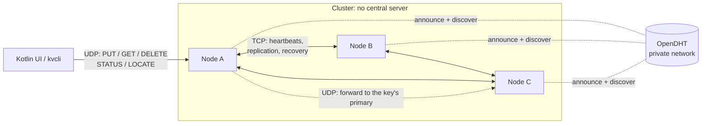

# Distributed Key-Value Database — Hybrid UDP/TCP Networking

A decentralized, in-memory key-value database in **C++23** for Linux. Nodes
find each other through a DHT, keep two copies of every key, notice when a node
fails, and rebuild its data when it comes back. There is no central server:
any node answers any request.

- **UDP data channel** for `PUT` / `GET` / `DELETE`, over a compact binary protocol
- **TCP control channel** between nodes for heartbeats, replication and recovery
- **OpenDHT discovery**: new nodes join a running cluster without configuration
- **XOR-distance placement**: every node computes where a key lives on its own
- **Replication factor 2**: reads keep working when a node dies
- **Failure detection** within 1 s, including frozen nodes
- **Recovery and rebalancing**: restarted and newly joined nodes get their keys
- **One epoll event loop per node**: no locks in the engine
- **Kotlin desktop UI** (separate component) on top of the `STATUS` / `LOCATE` requests



**How it works inside:** [`docs/architecture.md`](docs/architecture.md) ·
**Wire protocol:** [`docs/protocol.md`](docs/protocol.md)

---

## See it run

```bash
./scripts/demo.sh             # pauses before each step (for presenting)
./scripts/demo.sh --no-pause  # straight through
```

The demo starts real nodes on this machine and walks through discovery, a crash
(reads keep working), a frozen node (caught by heartbeats), recovery after a
restart, and a fourth node joining (keys move to it). It stops everything at
the end. Logs: `demo-logs/`.

---

## Build

Requirements: Linux, GCC 13+ (14 recommended), CMake 4.3+,
[OpenDHT](https://github.com/savoirfairelinux/opendht) (found via `pkg-config`).
GoogleTest is downloaded automatically.

```bash
cmake -S . -B build -DCMAKE_CXX_COMPILER=g++-14 -DCMAKE_C_COMPILER=gcc-14
cmake --build build
```

On Ubuntu 22.04 the default GCC 11 is too old, hence the compiler flags above.
Add `-DKVDB_SANITIZE=ON` for an AddressSanitizer + UBSan build.

---

## Run

Start a cluster, one terminal per node:

```bash
./build/k_v_db --listen [::1]:9001 --dht 4001
./build/k_v_db --listen [::1]:9002 --dht 4002 --bootstrap [::1]:4001
./build/k_v_db --listen [::1]:9003 --dht 4003 --bootstrap [::1]:4001
```

Then talk to any node:

```bash
./build/kvcli ::1 9001 put student101 John     # OK
./build/kvcli ::1 9003 get student101          # John
./build/kvcli ::1 9002 delete student101       # OK
./build/kvcli ::1 9001 status                  # how this node sees the cluster
./build/kvcli ::1 9001 locate student101       # which two nodes hold the key
```

```
$ ./build/kvcli ::1 9001 status
node bc1a4cd7bb26658f: 4 keys stored, replication factor 2
           bc1a4cd7bb26658f  [::1]:9001               SELF
           5d464f8d10c03f04  [::1]:9002               CONNECTED
           f1dc4db431c88ced  [::1]:9003               CONNECTED
```

<details>
<summary>All options</summary>

```
k_v_db [--listen <endpoint>] [--peer <endpoint>]...
       [--dht <port> [--bootstrap <endpoint>] [--cluster <name>]]

  --listen     this node's address (default [::1]:9000); UDP data and TCP
               control both use this port number
  --peer       a node known in advance (repeat for each); an alternative to --dht
  --dht        discover nodes through OpenDHT on this UDP port
  --bootstrap  an existing node's DHT endpoint (omit on the first node)
  --cluster    nodes with the same name form one cluster (default kvdb)

  endpoint:    [::1]:9001  or  127.0.0.1:9001

kvcli <host> <port> put <key> <value> | get <key> | delete <key> | status | locate <key>
  exit codes: 0 OK, 1 error status (e.g. NOT_FOUND), 2 usage error or no answer
```

</details>

---

## Test

```bash
ctest --test-dir build --output-on-failure    # 124 unit tests
```

The unit tests run whole clusters on a simulated in-memory network: routing,
replication, failures, duplicate requests, recovery, divergent copies, deletes
and nodes joining. `scripts/demo.sh` is the end-to-end test on real sockets.

---

## Limitations

Deliberate simplifications for the scope of a course project:

- **In memory only:** if both nodes holding a key fail at once, the key is lost.
- **Writes need both copies:** while one of a key's two nodes is down, writes to
  it fail (reads still work). Consistency is preferred over write availability.
- **Nodes are only added:** a node that leaves for good stays listed as down.
- **No authentication:** meant for a trusted network.

---

## Team

| Member | Responsibility |
|---|---|
| Anri Vasilevi | |
| Chamod Chirantha Dilshan | |
| Imesh Samaraweera | |
| Amr Mohamed Henidy Henidy Farh | |
| Zakria Ibrahim Abukhattala | |

*Course project, Riga Technical University.*
