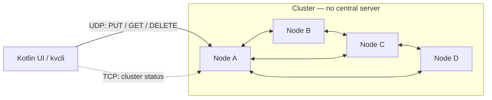
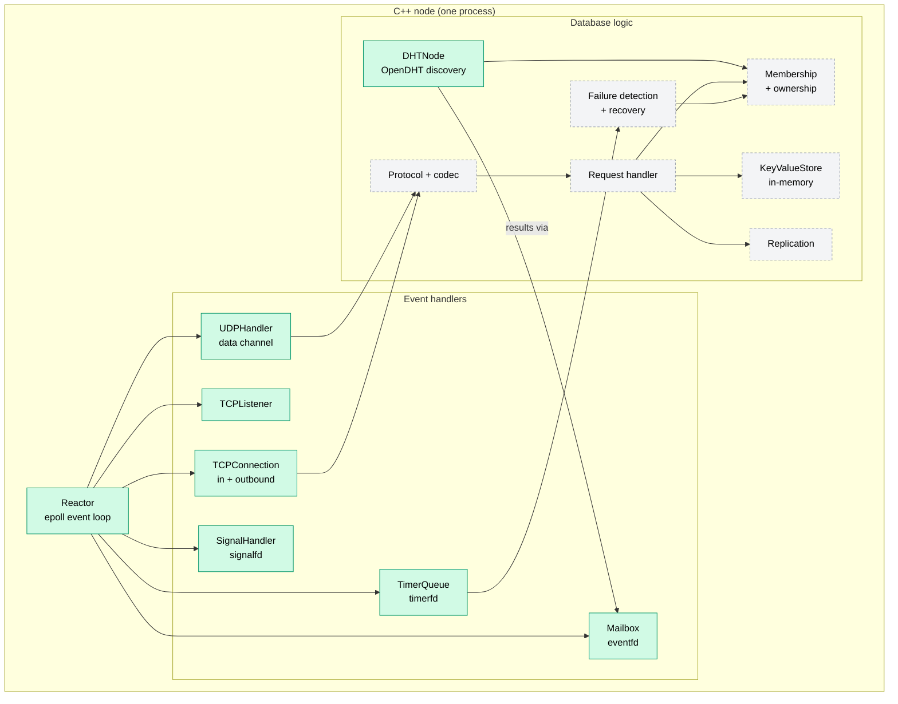
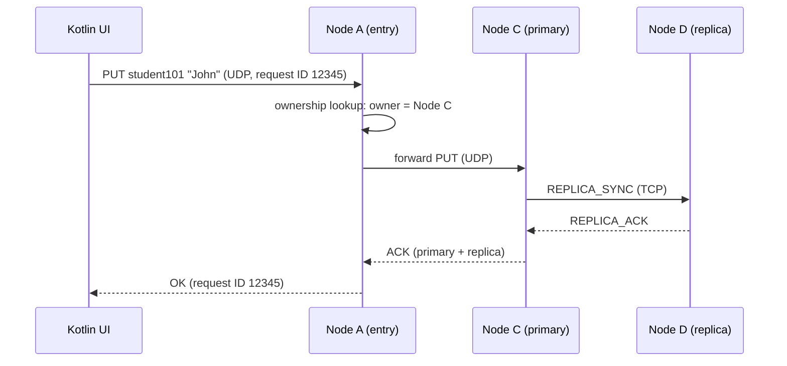
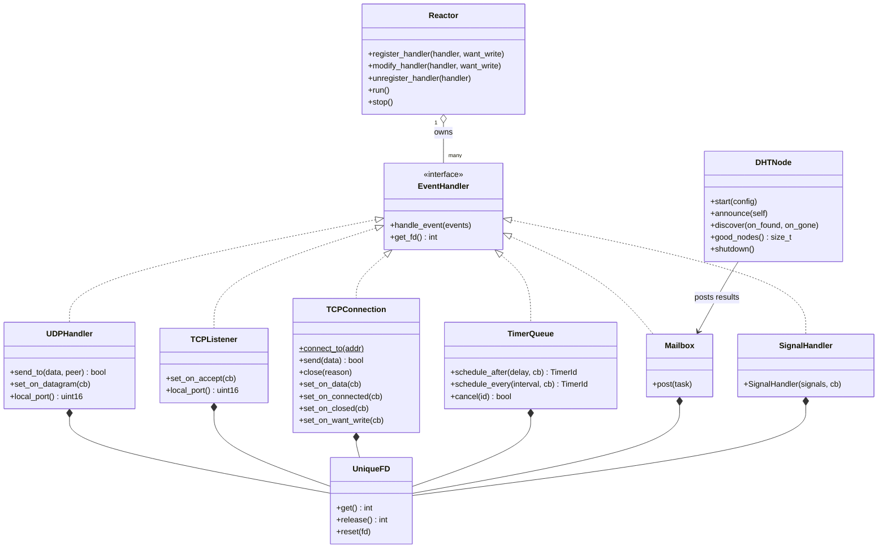
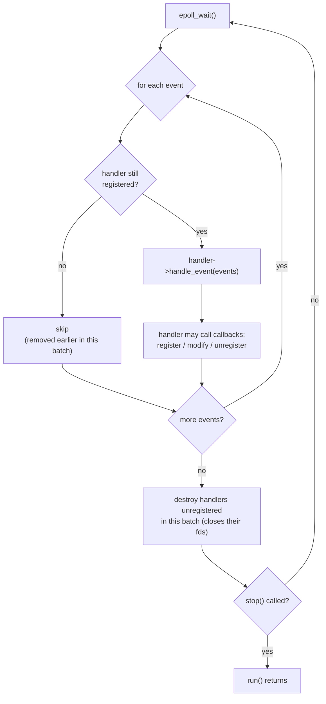
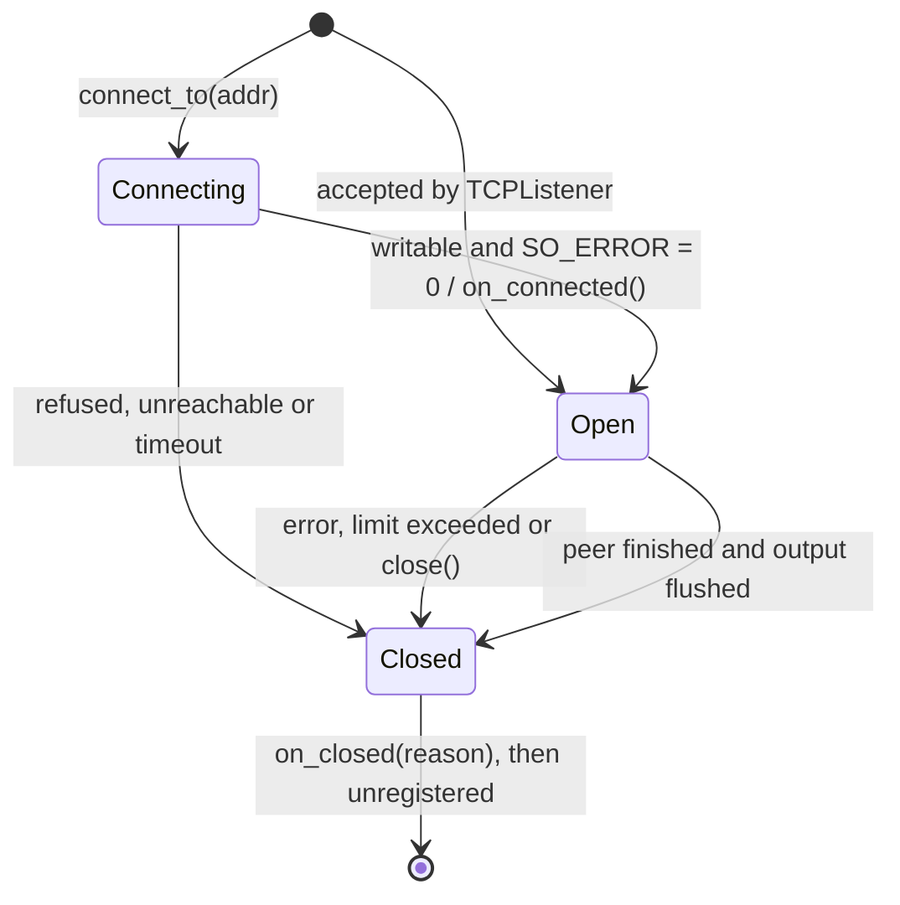
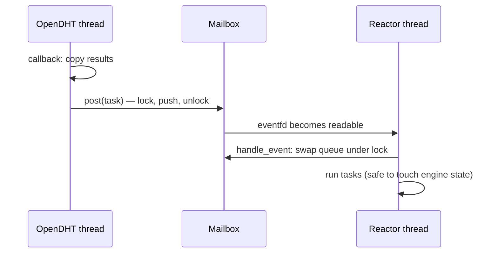

# Distributed Key-Value Database — Hybrid UDP/TCP Networking

A decentralized, in-memory key-value database written in **C++23** for Linux.
Data is spread across independent nodes with no central server: a Kademlia DHT
(**OpenDHT**) handles node discovery, keys are placed on nodes by XOR distance,
every key is replicated on two nodes, and failed nodes are detected and their
replicas rebuilt automatically.

- **UDP data channel** — fast `PUT` / `GET` / `DELETE` operations, with
  application-level reliability (request IDs, timeouts, retries, duplicate detection).
- **TCP control channel** — reliable node-to-node coordination: membership,
  heartbeats, replication and recovery.
- **OpenDHT** — nodes announce themselves in a private DHT and discover each other;
  a new node only needs the address of one existing node.
- **One epoll event loop per node** — all sockets, timers, signals and cross-thread
  work handled by a single thread, no locks inside the engine.
- **Kotlin desktop UI** — sends commands and visualizes the cluster (separate component).

> **Status:** the engine foundation is complete — reactor, UDP/TCP transport,
> timers, cross-thread mailbox, clean shutdown, and OpenDHT-based node discovery.
> Next is the database logic: protocol, storage, routing, replication — see [Roadmap](#roadmap).

---

## Contents

- [Target architecture](#target-architecture)
- [Engine design principles](#engine-design-principles)
- [What is implemented](#what-is-implemented)
- [Project structure](#project-structure)
- [Building](#building)
- [Running](#running)
- [Testing](#testing)
- [Roadmap](#roadmap)
- [Team](#team)

---

## Target architecture

The finished system: clients talk to **any** node; nodes forward requests to the
key's owner and replicate it to a second node.



Inside each node (green = implemented, grey = planned):



Planned flow of a `PUT` (replication factor 2):



---

## Engine design principles

These rules hold across the whole engine and keep it simple and safe.

**1. Single-threaded reactor.**
Each node runs one epoll event loop. Every socket, timer, signal and cross-thread
notification is a handler in that loop, so engine state is only ever touched by
one thread — no locks needed.

**2. Other threads never touch engine state.**
OpenDHT runs its own threads. Its callbacks only copy their results and *post* a
task to the `Mailbox`; the task runs on the reactor thread.

**3. Handlers own their file descriptors; the reactor owns the handlers.**
Every descriptor lives in a `UniqueFD` inside its handler. The reactor stores
handlers (`std::unique_ptr<EventHandler>`) and identifies them by pointer — it
never stores or exposes descriptors, and only touches one when calling `epoll_ctl`.

**4. Handlers don't know the reactor.**
Handlers communicate outward only through callbacks (`std::move_only_function`):
`on_datagram`, `on_accept`, `on_data`, `on_want_write`, `on_connected`,
`on_closed`. The code that creates a handler wires those callbacks to the
reactor. This keeps transport code testable on its own.

**5. Edge-triggered epoll.**
Handlers read / accept / write until `EAGAIN`, because epoll reports each
readiness change only once.

**6. Deferred destruction.**
`unregister_handler()` removes a handler from epoll immediately but destroys it
only after the current batch of events. A handler can safely remove itself from
inside its own callback, and its descriptor number can't be reused mid-batch.

**7. Errors.**
Setup failures (socket, bind, listen) throw `std::system_error` — the node
fails loudly at startup. Runtime failures never throw out of the event loop:
they close the affected connection and report a `std::error_code` reason.



---

## What is implemented

### Utilities — `src/utils/`

| Component | Description |
|---|---|
| `UniqueFD` | Move-only RAII owner of a file descriptor; closes it exactly once. Unit-tested. |
| `error_utils.h` | `throw_errno()` helpers that turn `errno` into `std::system_error`. |
| `address.h` | `make_address(ip, port)` parses IPv6 or IPv4 (mapped to `::ffff:a.b.c.d`); `to_string(addr)` formats `[ip]:port` for logs. |

### Reactor — `src/reactor/`

The event loop around `epoll_wait`.



- Handlers are registered with `EPOLLIN | EPOLLRDHUP | EPOLLET`, plus `EPOLLOUT` on request.
- `epoll_event.data.ptr` holds the handler pointer; it stays valid for the whole
  batch thanks to deferred destruction.
- `EINTR` from `epoll_wait` is retried; real errors throw.

### Event handlers — `src/handlers/`

**`UDPHandler`** — the UDP data channel.
Non-blocking, dual-stack IPv6 socket. Reads every pending datagram per event and
passes each one (with the sender's address) to `on_datagram`. `send_to()` sends
one datagram; if the kernel buffer is full the datagram is dropped — the client's
retry handles it.

**`TCPListener`** — accepts incoming TCP connections.
Dual-stack, `SO_REUSEADDR` (nodes can restart immediately), `SOMAXCONN` backlog.
Accepts with `accept4` (non-blocking + close-on-exec in one call) until the
backlog is empty and hands each socket to `on_accept`. Rejecting a connection =
not taking the `UniqueFD`.

**`TCPConnection`** — one TCP connection, inbound or outbound.



- **Framing-agnostic reading:** `on_data` receives all unconsumed input and returns
  how many bytes it consumed; partial messages stay buffered for the next read.
- **Write queue:** `send()` writes what the kernel accepts and queues the rest;
  writable events are enabled only while data is waiting (`on_want_write`).
  Data sent while still connecting is queued and delivered once connected.
- **Half-close:** when the peer finishes sending, queued replies are still
  flushed before closing.
- **Limits:** 1 MiB unconsumed input, 8 MiB unsent output — exceeding either
  closes the connection.
- **Close reasons:** `on_closed(std::error_code)` is called exactly once; empty =
  normal close, otherwise refused / reset / timed out / limit exceeded.
- `TCP_NODELAY` for low latency, `MSG_NOSIGNAL` so a dead peer can't kill the process.

**`TimerQueue`** — many timers on a single `timerfd`.
Timers live in a min-heap; the timerfd is always armed for the earliest
absolute deadline (`CLOCK_MONOTONIC`).

- `schedule_after(delay, cb)` — one-shot (connect timeouts, request timeouts).
- `schedule_every(interval, cb)` — repeating without drift (heartbeats).
- `cancel(id)` — safe at any time, including from inside the timer's own callback.

**`Mailbox`** — hands work from other threads to the reactor thread.
A mutex-protected task queue plus an `eventfd`. `post(task)` is thread-safe;
tasks run on the reactor thread in posting order. Only the first task of a burst
wakes the reactor, and tasks run outside the lock, so they may post again.



**`SignalHandler`** — signals as ordinary reactor events (`signalfd`).
`SIGINT` / `SIGTERM` are blocked and delivered through the event loop, so the
callback can safely call `reactor.stop()` → clean shutdown, exit code 0.
Must be created **before** any other thread starts, so all threads inherit the
blocked signals.

### DHT — `src/dht/`

**`DHTNode`** — cluster membership through OpenDHT.

- Runs OpenDHT on a **private network id**, so nodes never mix with the public DHT.
- Every node **announces** its `NodeInfo` (node id, IP, UDP and TCP port) under a
  shared cluster key; the announcement is re-published automatically while the
  node runs.
- Every node **listens** on that key: `on_found` reports new nodes, `on_gone`
  reports expired announcements. Its own announcement is never reported.
- All callbacks are delivered **through the Mailbox**, so they run on the reactor thread.
- A new node only needs the address of **one** existing node to bootstrap.

**`NodeInfo`** — what a node announces; serialized with msgpack (`MSGPACK_DEFINE`).
The IP is a string, so it works for both IPv6 and IPv4.

> OpenDHT handles **discovery** (which nodes exist). It is not the failure
> detector: expired announcements appear only after minutes. Fast failure
> detection will come from heartbeats on the TCP control channel.

---

## Project structure

```
k_v_db/
├── CMakeLists.txt
├── main.cpp                     # demo / manual test harness
├── src/                         # engine — compiled into the kvdb_core library
│   ├── reactor/
│   │   ├── reactor.h
│   │   └── reactor.cpp
│   ├── handlers/
│   │   ├── event_handler.h      # handler interface
│   │   ├── udp_handler.h/.cpp
│   │   ├── tcp_listener.h/.cpp
│   │   ├── tcp_connection.h/.cpp
│   │   ├── timer_queue.h/.cpp
│   │   ├── mailbox.h/.cpp
│   │   └── signal_handler.h/.cpp
│   ├── dht/
│   │   ├── node_info.h
│   │   └── dht_node.h/.cpp
│   └── utils/
│       ├── unique_fd.h
│       ├── error_utils.h
│       └── address.h
├── tools/
│   └── dht_spike.cpp            # multi-process discovery test
└── tests/
    └── unique_fd_test.cpp
```

**CMake layout:** all engine code is built once into the static library
`kvdb_core`, which also carries the include path, warning flags and dependencies
(Threads, OpenDHT). Every executable — `k_v_db`, `dht_spike`, `unit_tests` — just
links `kvdb_core`.

---

## Building

### Requirements

- Linux (the engine uses epoll, timerfd, eventfd, signalfd)
- GCC 14+ or Clang with C++23 support
- CMake 4.3+
- [OpenDHT](https://github.com/savoirfairelinux/opendht) (built from source) and
  its dependencies (msgpack, GnuTLS, …), discoverable through `pkg-config`
- git (CMake downloads GoogleTest automatically)
- `nc` (netcat) for manual testing

Check that OpenDHT is found:

```bash
pkg-config --modversion opendht
```

If it is installed but not found, add its `.pc` folder to `PKG_CONFIG_PATH`.
If the program later fails with *"error while loading shared libraries:
libopendht.so"*, run `sudo ldconfig` once.

### Build

```bash
cmake -S . -B build
cmake --build build
```

With AddressSanitizer + UndefinedBehaviorSanitizer:

```bash
cmake -S . -B build-asan -DKVDB_SANITIZE=ON -DCMAKE_BUILD_TYPE=Debug
cmake --build build-asan
```

---

## Running

### Engine demo — `k_v_db`

`main.cpp` is currently a manual test harness that wires the components together:

- UDP echo server on port **9000**, TCP echo server on port **9001**
- outbound connection tests: success, refused, and timeout (3 s)
- a repeating timer that ticks 3 times and cancels itself
- a background thread posting 3 tasks through the `Mailbox`
- clean shutdown on Ctrl+C / `SIGTERM`

```bash
./build/k_v_db
```

Expected output (thread ids and ports differ; some lines may be reordered):

```
UDP echo listening on port 9000
TCP echo listening on port 9001
out: connecting to [::1]:9001
out: connecting to [::1]:9999
out: connecting to [::ffff:10.255.255.1]:9001
reactor thread: 5150
tcp: accepted [::1]:48128
out: connected to [::1]:9001
out: [::1]:9999 closed: Connection refused
out: echo received: hello from connector
out: [::1]:9001 closed normally
tcp: [::1]:48128 closed normally
mailbox: task 1 posted by thread 5151, running on thread 5150
timer: tick 1
mailbox: task 2 posted by thread 5151, running on thread 5150
mailbox: task 3 posted by thread 5151, running on thread 5150
timer: tick 2
timer: tick 3
out: [::ffff:10.255.255.1]:9001 closed: Connection timed out
^C
signal 2 (Interrupt): shutting down
reactor stopped, exiting cleanly
```

### Node discovery — `dht_spike`

Start several nodes; each one announces itself and prints every node it discovers.

```bash
./build/dht_spike 4222 ::1                       # terminal 1: first node
./build/dht_spike 4223 ::1 127.0.0.1 4222        # terminal 2: joins via node 1
./build/dht_spike 4224 ::1 127.0.0.1 4222        # terminal 3: joins via node 1
```

Usage: `dht_spike <dht_port> <advertised_ip> [bootstrap_host bootstrap_port]`.

Expected: each node prints a `FOUND` line for every other node — including nodes
it did not bootstrap from — and the thread id equals its own reactor thread:

```
node 4c955dc9bc6a20d7, reactor thread 7184
FOUND node 3d61bf308f5b4505 at ::1 (udp 5222, tcp 6222) [thread 7184]
FOUND node 6396fd78b7674229 at ::1 (udp 5223, tcp 6223) [thread 7184]
dht: 2 known nodes
^C
shutting down
stopped cleanly
```

(The UDP/TCP ports in the spike are placeholders: DHT port + 1000 / + 2000.)

---

## Testing

### Unit tests (GoogleTest)

```bash
cmake --build build --target unit_tests
ctest --test-dir build --output-on-failure
```

Currently covered: `UniqueFD` (ownership, moves, `release`, `reset`).

### Manual tests

With `k_v_db` running:

| Test | Command | Expected |
|---|---|---|
| TCP echo | `nc ::1 9001` | typed lines come back |
| Several clients | `nc ::1 9001` in 2–3 terminals | each echoes only its own text |
| IPv4 (dual-stack) | `nc 127.0.0.1 9001` | server logs `[::ffff:127.0.0.1]` |
| UDP echo | `nc -u ::1 9000` | typed lines come back |
| Abrupt disconnect | `pkill -9 nc` while connected | server logs the close and keeps running |
| Clean shutdown | Ctrl+C or `kill <pid>` | `reactor stopped, exiting cleanly`, exit code 0 |

Large transfer — exercises partial writes, the write queue and half-close:

```bash
head -c 20000000 /dev/urandom > /tmp/in.bin
nc -N ::1 9001 < /tmp/in.bin > /tmp/out.bin     # traditional netcat: use -q 2 instead of -N
cmp /tmp/in.bin /tmp/out.bin && echo "IDENTICAL"
```

---

## Roadmap

### Engine (C++)

**Foundation** — complete
- [x] `UniqueFD` + unit tests
- [x] Reactor (epoll, edge-triggered, deferred destruction)
- [x] `UDPHandler` — UDP data channel transport
- [x] `TCPListener` — inbound connections
- [x] `TCPConnection` — inbound + outbound, write queue, half-close, limits, close reasons
- [x] `TimerQueue` — one-shot and repeating timers, connect timeouts
- [x] `Mailbox` (eventfd) — safe hand-off from other threads to the reactor
- [x] `SignalHandler` (signalfd) — clean shutdown on Ctrl+C / `SIGTERM`
- [x] `DHTNode` — OpenDHT node discovery (announce / discover), verified with 3 processes

**Database**
- [ ] Protocol specification (`docs/protocol.md`) + binary codec (header, message types, size limits) ← **next**
- [ ] Single-node `KeyValueStore` over UDP + `kvcli` command-line client
- [ ] Multi-node routing with a static node list (XOR-distance ownership, forwarding)
- [ ] TCP control channel: handshake (`HELLO`), reconnects, membership table
- [ ] Wire `DHTNode` into membership: discovery replaces the static node list
- [ ] Replication (factor 2, primary + replica must ACK) + duplicate detection
- [ ] Failure detection (heartbeats) + recovery (replica rebuild)
- [ ] Status API for the UI (`CLUSTER_STATUS`, key placement)
- [ ] Integration test scripts + demo scenario (kill a node, data survives)

### Kotlin UI

- [ ] Desktop app: `PUT` / `GET` / `DELETE` + live cluster view *(separate component)*

---
