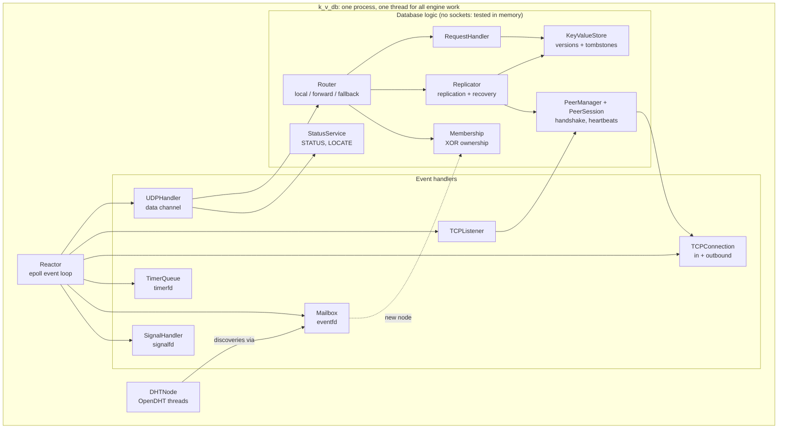
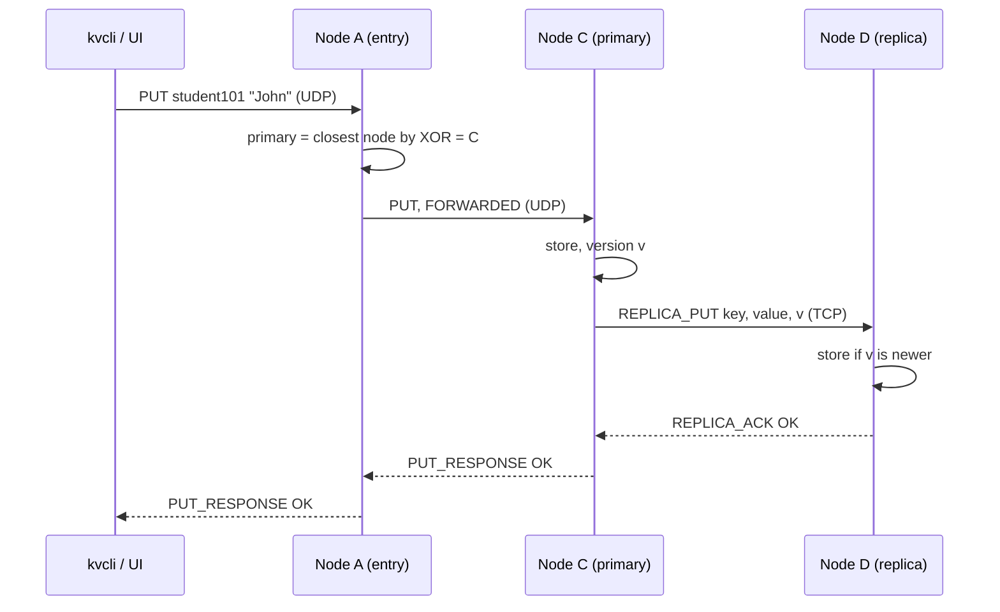

# Architecture

How the engine works inside: the design rules, the components, and how a
cluster places, replicates and recovers data. The byte-level wire format and
the exact cluster rules are in [`protocol.md`](protocol.md).

- [One node](#one-node)
- [How it works](#how-it-works)
- [Engine design principles](#engine-design-principles)
- [Components](#components)
- [Source layout](#source-layout)

---

## One node



---

## How it works

### Where a key lives

Every node has a 64-bit id: the hash of its address (`"[::1]:9001"`). Keys are
hashed into the same space. A key's **replica set** is the two nodes closest to
it by **XOR distance** (`node_id XOR hash(key)`): the closest is the
**primary**, the second the **replica**. Every node computes the same answer
from the same node list, so nobody has to be asked.

### A write

Clients may send to any node. Only the primary executes a write, and it answers
only after the replica has confirmed:



No replica ACK within 100 ms → `REPLICATION_FAILED`. Primary known to be down →
`UNAVAILABLE` right away. A client retry of a write that already ran gets the
stored answer (**duplicate detection**), so it is never applied twice.

### A read

The entry node asks the primary; if the primary doesn't answer within 200 ms,
or is already known to be down, it asks the replica, which may be itself.
**Reads survive the loss of a node.**

### Failure detection

Every control connection sends `PING` every 250 ms and expects `PONG`. After
4 missed `PONG`s (1 s) the peer is considered down and the connection is
closed. This also catches a node that is **frozen** (stopped, overloaded,
swapping) while its TCP connection stays open, which TCP alone never reports.

### Recovery and rebalancing

Every entry carries a **version** from a hybrid logical clock
(`max(last + 1, unix_ms << 16)`), and a `DELETE` leaves a **tombstone** instead
of erasing the key. A node applies a copy only if it is newer than its own.

Whenever a control connection comes up, both nodes send each other every entry
the other is responsible for. Because of the versions this is always safe, and
it covers several cases at once:

| Situation | Result |
|---|---|
| A node restarted with empty memory | It gets its keys back within milliseconds |
| Two copies diverged (after `REPLICATION_FAILED`) | Both end up with the newest version |
| A key was deleted while a node was away | The tombstone wins; the key stays deleted |
| A new node joined | It receives the keys whose replica set it is now in |

### Discovery

With `--dht`, each node announces `{id, ip, port}` under a cluster key in a
private OpenDHT network and listens on that key. A discovered node is checked
(its id must be the hash of its address), added to the membership, which
changes ownership at once, and connected to; recovery then moves its keys to
it. The lower id of every pair opens the TCP connection.

The full wire format and all the rules are specified in
[`protocol.md`](protocol.md).

---

## Engine design principles

**1. Single-threaded reactor.** Each node runs one epoll event loop. Every
socket, timer, signal and cross-thread notification is a handler in that loop,
so engine state is only ever touched by one thread, and there are no locks.

**2. Other threads never touch engine state.** OpenDHT runs its own threads.
Its callbacks only copy their results and *post* a task to the `Mailbox`; the
task runs on the reactor thread.

**3. Handlers own their file descriptors; the reactor owns the handlers.**
Every descriptor lives in a `UniqueFD` inside its handler. The reactor stores
handlers and identifies them by pointer; it never stores descriptors.

**4. Handlers don't know the reactor.** Handlers communicate outward only
through callbacks (`std::move_only_function`), wired up by whoever creates them.

**5. Logic doesn't know sockets.** `Router`, `Replicator`, `PeerSession`,
`RequestHandler` and `StatusService` take bytes in and hand bytes out through
callbacks. They are tested on simulated networks in memory: no ports, no
flakiness.

**6. Edge-triggered epoll.** Handlers read / accept / write until `EAGAIN`.

**7. Deferred destruction.** A handler or connection that closes while it is on
the call stack is destroyed only after the current batch of events.

**8. Never trust the network.** Every message is fully validated before use.
Invalid datagrams are dropped; a TCP peer that sends one invalid message is
disconnected. Ids are checked against addresses, replicas refuse keys they
aren't responsible for, and a reconnect attempt the peer already gave up on is
dropped.

**9. Errors.** Setup failures (port taken, bad arguments) stop the node with a
clear message. Runtime failures never escape the event loop: they close the
affected connection or answer with an error status.

---

## Components

### Foundation: `src/utils/`, `src/reactor/`, `src/handlers/`

| Component | Description |
|---|---|
| `UniqueFD` | Move-only RAII owner of a file descriptor. |
| `Reactor` | Edge-triggered epoll loop with deferred destruction. |
| `UDPHandler` | Non-blocking dual-stack UDP socket. |
| `TCPListener` | Accepts until the backlog is empty; `SO_REUSEADDR`. |
| `TCPConnection` | Inbound and outbound (non-blocking connect), write queue, half-close, size limits, close reasons, peer-FIN detection. |
| `TimerQueue` | Many timers on one `timerfd` (min-heap): one-shot and drift-free repeating. |
| `Mailbox` | `eventfd` + queue: other threads post tasks for the reactor thread. |
| `SignalHandler` | `signalfd`: SIGINT / SIGTERM become events → clean shutdown. |

### Protocol: `src/protocol/`

A 28-byte big-endian header plus payload, the same over UDP and TCP. Every
request fits in one unfragmented datagram (≤ 1232 bytes: keys ≤ 128 bytes,
values ≤ 1024 bytes). Decoding never throws: errors are values
(`std::expected`). Specification: [`protocol.md`](protocol.md).

### Database: `src/storage/`, `src/node/`

| Component | Description |
|---|---|
| `KeyValueStore` | Entries with versions and tombstones; `apply()` keeps the newer copy. |
| `RequestHandler` | Executes PUT / GET / DELETE on the local store. |
| `Router` | Local execution, forwarding to the primary, replica fallback for reads, loop protection, duplicate detection. |
| `Replicator` | Replication with ACKs and timeouts; recovery sync in batches. |
| `StatusService` | Answers `STATUS` (this node's view of the cluster) and `LOCATE` (a key's primary and replica). |
| `ResponseCache` | Bounded cache of recent write responses for duplicate detection. |

### Cluster: `src/cluster/`, `src/dht/`

| Component | Description |
|---|---|
| `hash.h` | FNV-1a 64 + SplitMix64 mix: deterministic on every machine. |
| `Membership` | The node list, XOR ownership and replica sets; grows at runtime. |
| `PeerSession` | One control connection: `HELLO` handshake, heartbeats, message delivery. |
| `PeerManager` | All control connections: who connects, handshake timeout, reconnect with backoff, heartbeat timer, stale-connection detection. |
| `DHTNode` | OpenDHT: announce, discover, results through the `Mailbox`. |

---

## Source layout

```
k_v_db/
├── CMakeLists.txt
├── main.cpp                     # the database node
├── docs/protocol.md             # wire protocol and cluster rules
├── scripts/demo.sh              # the live demo
├── src/                         # the engine, built into the kvdb_core library
│   ├── reactor/                 # epoll event loop
│   ├── handlers/                # UDP, TCP, timers, mailbox, signals
│   ├── protocol/                # header, codec, byte-order helpers
│   ├── storage/                 # KeyValueStore
│   ├── node/                    # Router, Replicator, RequestHandler, StatusService
│   ├── cluster/                 # hashing, Membership, PeerSession, PeerManager
│   ├── dht/                     # OpenDHT discovery
│   └── utils/                   # UniqueFD, errors, addresses
├── tools/
│   ├── kvcli.cpp                # command-line client
│   ├── engine_demo.cpp          # foundation demo (echo servers, timers)
│   └── dht_spike.cpp            # standalone discovery test
└── tests/                       # GoogleTest unit tests
```
